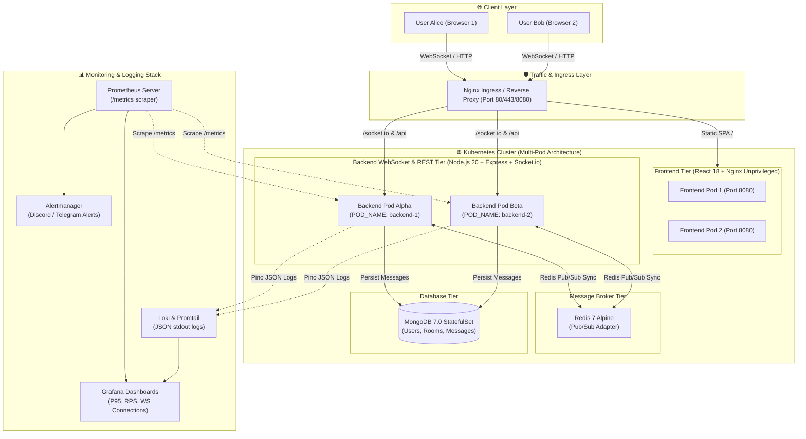

# REALTIME DISTRIBUTED WEB CHAT (DEVOPS CLOUD-NATIVE ARCHITECTURE)

[](./Jenkinsfile)
[](./k8s)
[](./terraform)
[](./ansible)
[](./.gitleaks.toml)
[](./monitoring)

> **Đồ án môn học DevOps - Đề tài 5: Hệ thống Web Chat thời gian thực Đa Pod (Real-time Multi-Pod Web Chat)**  
> **Nguyên tắc thiết kế:** "Everything as Code" (IaC, CaC, PaC, DevSecOps), Cloud-Native 100%, Không rò rỉ secret, Vận hành ổn định không downtime.

---

## 1. SƠ ĐỒ KIẾN TRÚC TỔNG THỂ (SYSTEM ARCHITECTURE)



---

## 2. BẢNG CÔNG NGHỆ SỬ DỤNG (TECH STACK)

| Thành phần | Công nghệ | Phiên bản | Vai trò & Lý do lựa chọn |
| :--- | :--- | :--- | :--- |
| **Frontend** | React + TypeScript + Vite | 18.3.1 / Vite 5 | SPA hiệu năng cao, render nhanh, Type-safety |
| **Styling** | TailwindCSS + Lucide Icons | 3.4.4 | Glassmorphism giao diện tối hiện đại, responsive |
| **Frontend Webserver** | Nginx Unprivileged | Alpine (non-root) | Bảo mật container, phục vụ static asset và Reverse Proxy |
| **Backend API** | Node.js + Express + TypeScript | 20 LTS | Xử lý REST API và điều phối luồng socket |
| **WebSocket** | Socket.io + Redis Adapter | 4.7.5 | Duy trì kết nối realtime 2 chiều, tự động reconnect |
| **Message Broker** | Redis | 7 Alpine | Cơ chế Pub/Sub đồng bộ hóa sự kiện giữa các Pod song song |
| **Database** | MongoDB | 7.0 Jammy | Lưu trữ phi cấu trúc NoSQL (Message history, Rooms, Users) |
| **Logging** | Pino + Pino-HTTP | 9.1 | Xuất structured JSON log ra stdout đạt chuẩn 12-Factor App |
| **Metrics** | prom-client | 15.1 | Thu thập custom metrics: `ws_active_connections`, `http_requests_total` |
| **Container Engine** | Docker & Docker Compose | Docker 29+ | Đóng gói Multi-stage build, tối ưu kích thước image (<150MB) |
| **Orchestration** | Kubernetes (K3s) + Kustomize | K8s v1.30+ | Tự động điều phối, HPA scale theo CPU, PodDisruptionBudget |
| **IaC** | Terraform | 1.5+ | Tự động khởi tạo VPC, Subnet, Security Group, 3 Máy ảo Cloud |
| **CaC** | Ansible | 2.15+ | Cấu hình tự động cài đặt Docker, K3s, Node Exporter, Hardening |
| **CI/CD** | Jenkins Declarative Pipeline | Latest | Pipeline 12 bước tự động: Test, Secret Scan, Trivy, Deploy |
| **Bảo mật** | Gitleaks & Trivy | Latest | Quét secret trong git history và quét CVE trong container image |
| **Kiểm thử tải** | k6 (Grafana) | Latest | Kịch bản bắn tải giả lập >100 kết nối WebSocket đồng thời |

---

## 3. CẤU TRÚC THƯ MỤC DỰ ÁN ("EVERYTHING AS CODE")

```text
realtime-chat-devops/
├── .gitleaks.toml                    # Quy tắc quét bảo mật ngăn chặn lộ mật khẩu/secret
├── .husky/pre-commit                 # Git hook chặn commit nếu vi phạm linting hoặc secret
├── .env.example                      # Biến môi trường mẫu cấu hình toàn hệ thống
├── docker-compose.yml                # Dựng toàn bộ môi trường Đa Pod bằng 1 lệnh duy nhất
├── docker-compose.test.yml           # Môi trường kiểm thử tích hợp tự động cho CI/CD
├── Jenkinsfile                       # Declarative CI/CD Pipeline 12 giai đoạn
├── RUNBOOK.md                        # Sổ tay vận hành, 8 bước demo vấn đáp, xử lý sự cố SRE
├── README.md                         # Tài liệu kiến trúc và hướng dẫn cài đặt từ máy trắng
├── backend/                          # Mã nguồn Server WebSocket + REST API
│   ├── src/
│   │   ├── config/env.ts             # Đọc và validate biến môi trường (Zod)
│   │   ├── utils/logger.ts           # Pino JSON Logger xuất stdout
│   │   ├── utils/metrics.ts          # Prometheus Custom Metrics (prom-client)
│   │   ├── models/                   # Mongoose Schemas (User, Room, Message)
│   │   ├── routes/                   # REST Endpoints (/health, /metrics, /api/rooms, /api/simulate-error)
│   │   ├── socket/                   # Socket.io + Redis Pub/Sub Adapter logic
│   │   └── server.ts                 # Entrypoint + Graceful Shutdown handler
│   ├── tests/                        # Unit Test & Integration Test (Jest + Supertest + Socket.io)
│   └── Dockerfile                    # Multi-stage, Alpine, non-root user UID 10001, HEALTHCHECK
├── frontend/                         # Mã nguồn Web Chat SPA
│   ├── src/
│   │   ├── components/               # PodStatusBar, SidebarRooms, ChatWindow, LoginModal
│   │   ├── hooks/useSocket.ts        # Quản lý WebSocket state, auto-reconnect, latency
│   │   └── App.tsx
│   ├── nginx/nginx.conf              # Nginx non-root, SPA fallback, WebSocket reverse proxy
│   └── Dockerfile                    # Multi-stage, nginx-unprivileged:alpine, HEALTHCHECK
├── scripts/                          # Bài 3: Quản trị Linux & DBA Scripts
│   ├── harden-linux.sh               # Hardening máy chủ: UFW, Fail2ban, SSH key, logrotate
│   ├── backup-mongodb.sh             # Backup CSDL định kỳ nén gzip, retention 7 ngày
│   ├── restore-mongodb.sh            # Khôi phục dữ liệu từ bản backup có kiểm tra an toàn
│   └── server-healthcheck.sh         # Script SRE đo CPU, RAM, Disk, Service status
├── terraform/                        # Bài 8: Hạ tầng dạng mã (IaC)
│   ├── modules/compute_node/         # Module tự viết khởi tạo EC2, EBS, Security Group
│   ├── main.tf                       # Tạo VPC + 1 Jenkins VM + 2 K3s Cluster VMs
│   ├── variables.tf
│   └── outputs.tf
├── ansible/                          # Bài 7: Cấu hình tự động
│   ├── inventories/                  # Inventories phân tách staging và production
│   ├── group_vars/all/vault.yml      # Ansible Vault mã hóa secret
│   ├── roles/                        # common, docker, k3s, jenkins_agent, node_exporter
│   └── site.yml                      # Playbook chính điều phối toàn bộ hạ tầng
├── k8s/                              # Bài 9 & 11: Kubernetes Manifests & Kustomize
│   ├── base/                         # StatefulSet, Deployments, HPA, PDB, Ingress, RBAC, NetworkPolicy
│   └── overlays/                     # Overlays môi trường staging và production
├── monitoring/                       # Bài 10: Giám sát, Cảnh báo & Logging
│   ├── prometheus-values.yaml        # Scrape config cho Prometheus Operator
│   ├── alert-rules.yaml              # Cảnh báo HighWebSocketConnections, High5xxErrorRate
│   ├── alertmanager-config.yaml      # Định tuyến thông báo lỗi tới Discord/Telegram
│   ├── grafana-dashboard.json        # Dashboard JSON mẫu nhập trực tiếp vào Grafana
│   └── loki-promtail-values.yaml     # Promtail trích xuất JSON log ra nhãn lọc Loki
└── load-test/
    └── ws-load-test.js               # Kịch bản k6 kiểm thử tải >100 WebSocket connections
```

---

## 4. HƯỚNG DẪN DỰNG HỆ THỐNG TỪ MÁY TRẮNG (STEP-BY-STEP)

### Cách A: Chạy Ngay Trên Máy Cục Bộ (Laptop Windows/macOS/Linux)
Yêu cầu: Đã cài đặt Docker Desktop.
```bash
# 1. Clone repository
git clone https://github.com/Doanxuannam05/Devopsdemo.git
cd Devopsdemo

# 2. Khởi chạy toàn bộ hệ thống bằng 1 lệnh duy nhất
docker compose up --build -d

# 3. Mở trình duyệt trải nghiệm hệ thống
open http://localhost:3000
```

### Cách B: Triển khai Lên Đám mây (AWS Cloud) Bằng Terraform & Ansible
```bash
# 1. Khởi tạo hạ tầng Cloud bằng Terraform
cd terraform
cp terraform.tfvars.example terraform.tfvars
terraform init
terraform plan
terraform apply -auto-approve

# 2. Cấu hình tự động các máy ảo bằng Ansible
cd ../ansible
ansible-playbook -i inventories/production/hosts.ini site.yml

# 3. Triển khai ứng dụng lên cụm Kubernetes K3s
cd ../k8s/overlays/production
kubectl apply -k .
```

---

## 5. ĐẶC TẢ REST API VÀ WEBSOCKET EVENTS

### 5.1 Các REST Endpoints Chính
| Method | Endpoint | Mô tả | Tham số / Body |
| :--- | :--- | :--- | :--- |
| `GET` | `/health` | Kiểm tra toàn diện tình trạng Pod, MongoDB và Redis | Trả về JSON trạng thái `200` hoặc `503` |
| `GET` | `/health/live` | K8s Liveness Probe | Trả về `{ status: "live", podName }` |
| `GET` | `/health/ready` | K8s Readiness Probe | Kiểm tra sẵn sàng đón request |
| `GET` | `/metrics` | Prometheus Metrics Scraper | Trả về số liệu chuẩn định dạng Prometheus |
| `GET` | `/api/rooms` | Lấy danh sách toàn bộ các phòng chat | Trả về danh sách Rooms |
| `POST` | `/api/rooms` | Tạo phòng chat mới | Body: `{ "name": "DevOps", "description": "..." }` |
| `GET` | `/api/rooms/:id/messages` | Tải lịch sử 50 tin nhắn gần nhất | Query: `?limit=50` |
| `GET` | `/api/simulate-error` | Giả lập lỗi SRE phục vụ vấn đáp | Query: `?type=500` hoặc `?type=cpu` hoặc `?type=delay` |

### 5.2 Các WebSocket Events
| Tên Event | Chiều gửi | Dữ liệu (Payload) | Ý nghĩa |
| :--- | :--- | :--- | :--- |
| `connection_established` | Server -> Client | `{ socketId, connectedPod, timestamp }` | Xác nhận bắt tay thành công |
| `user_login` | Client -> Server | `{ username, avatar }` | Đăng ký thông tin người dùng |
| `join_room` | Client -> Server | `{ roomId, username }` | Gia nhập kênh chat |
| `send_message` | Client -> Server | `{ roomId, sender, avatar, text }` | Gửi tin nhắn mới vào phòng |
| `new_message` | Server -> All Clients | `{ _id, roomId, sender, text, senderPod, createdAt }` | Broadcast tin nhắn qua Redis Pub/Sub |
| `typing` | Client -> Server | `{ roomId, username, isTyping }` | Báo hiệu đang gõ phím |

---

## 6. ƯỚC TÍNH CHI PHÍ HẠ TẦNG ĐÁM MÂY (CLOUD COST ESTIMATION)

Chi phí triển khai mô hình chuẩn bài toán Đồ án DevOps:

| Thành phần | Cấu hình máy ảo | Nhà cung cấp AWS (ap-southeast-1) | Nhà cung cấp DigitalOcean | Chi phí / Tháng |
| :--- | :--- | :--- | :--- | :--- |
| **Jenkins Controller** | 2 vCPU, 8GB RAM, 50GB SSD | `t3.large` ($60.74/tháng) | 2 vCPU, 8GB ($48/tháng) | ~$50 - $60 |
| **K3s Master Node** | 2 vCPU, 4GB RAM, 35GB SSD | `t3.medium` ($30.37/tháng) | 2 vCPU, 4GB ($24/tháng) | ~$25 - $30 |
| **K3s Worker Node** | 2 vCPU, 4GB RAM, 35GB SSD | `t3.medium` ($30.37/tháng) | 2 vCPU, 4GB ($24/tháng) | ~$25 - $30 |
| **Network & Egress** | Băng thông ra Internet 50GB | AWS Internet Gateway | Droplet Transfer included | ~$4.50 |
| **TỔNG CỘNG** | **3 Máy ảo Cloud chuyên dụng** | **~$125.98 / Tháng** | **~$96.00 / Tháng** | **~2.4 - 3.1 triệu VNĐ** |

> 💡 **Khuyến nghị Tối ưu Chi phí cho Sinh viên:** Sử dụng gói **AWS Free Tier** kết hợp máy chủ Spot Instances (`Spot Pricing` giảm 70% còn ~$35/tháng) hoặc dựng trên cụm máy tính nội bộ (Bare-metal On-Premise) với Proxmox/VMware chi phí 0 đồng!

---

## 7. BẢNG KIỂM TRA DEVSECOPS & BẢO MẬT (SECURITY CHECKLIST)

- [x] **Container Không chạy quyền Root:** Cả Backend (`nodejs` UID 10001) và Frontend (`nginx` UID 101) đều chạy dưới unprivileged user.
- [x] **Không Commit Mật khẩu/Secret:** Toàn bộ mật khẩu được quản lý qua biến môi trường `.env`, Ansible Vault và K8s Secrets; có file `.gitleaks.toml` quét trước khi commit.
- [x] **Quét lỗ hổng Container:** Tích hợp công cụ **Trivy** trong Jenkinsfile quét mức độ `HIGH, CRITICAL`.
- [x] **Cô lập luồng mạng (NetworkPolicy):** Database MongoDB và Redis bị cô lập hoàn toàn, không thể bị truy cập từ bên ngoài ngoài trừ Pod Backend.
- [x] **Phân quyền tối thiểu (Least Privilege RBAC):** ServiceAccount chỉ có quyền đọc tài nguyên ConfigMap và Endpoints cần thiết.
- [x] **Khả năng tự phục hồi (Zero-Downtime):** Tích hợp `PodDisruptionBudget` và `RollingUpdate` đảm bảo cập nhật không rớt kết nối.

---

*Tác giả: Nhóm Sinh viên Thực hiện Đề tài 5 - Đồ án DevOps*  
*Mã nguồn mở và sẵn sàng 100% cho buổi bảo vệ vấn đáp!*
